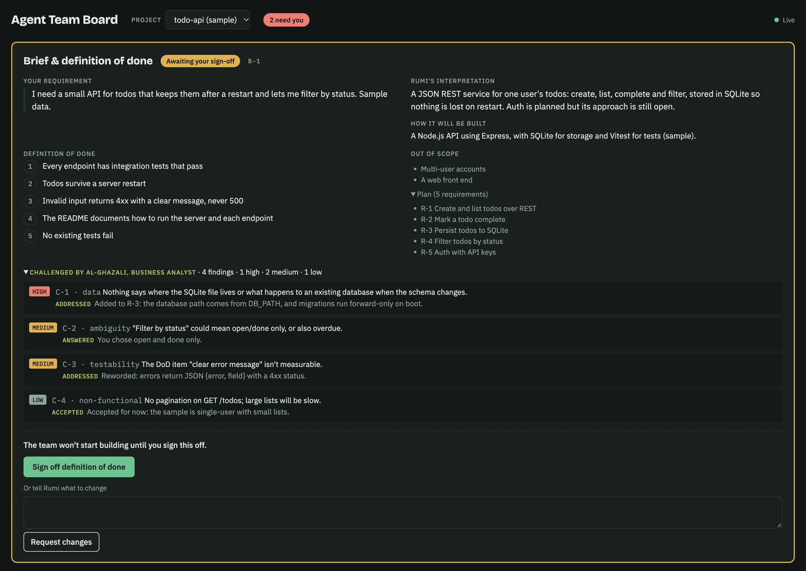
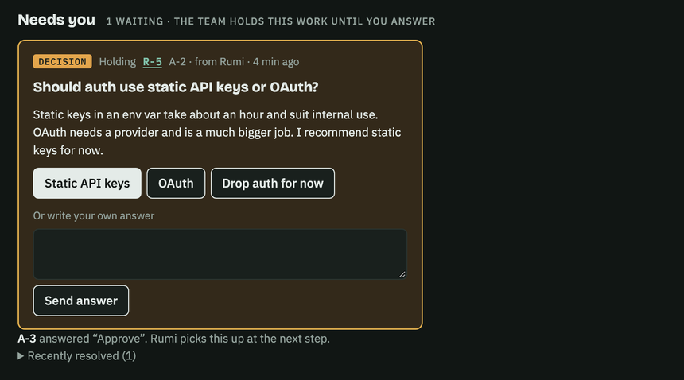
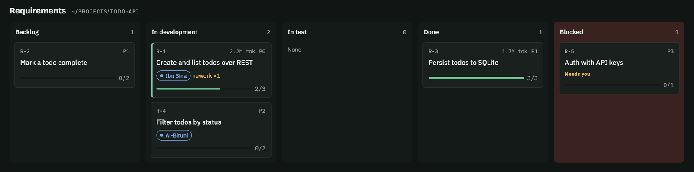
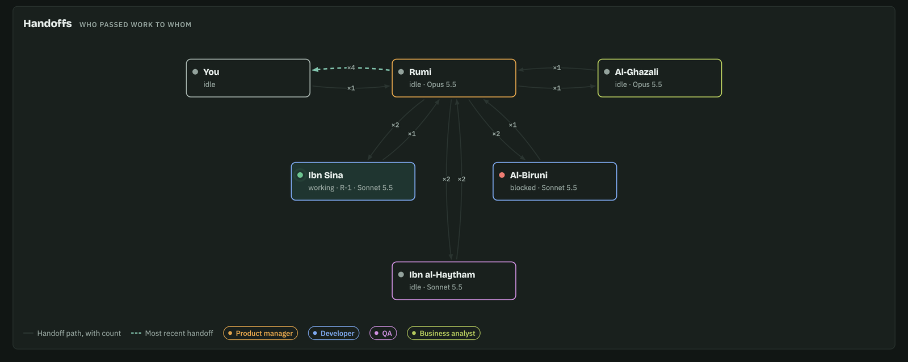
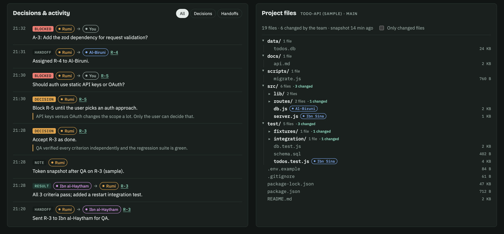
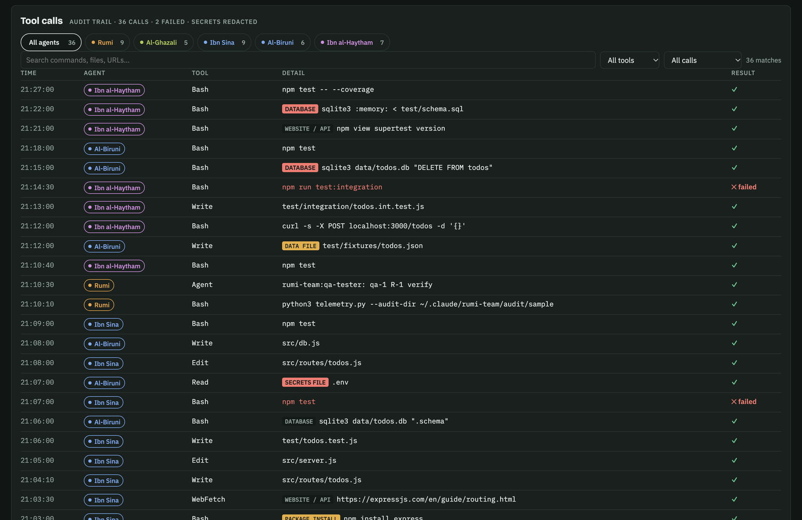
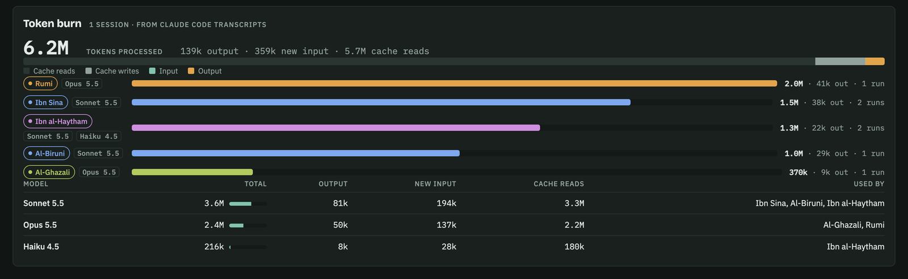
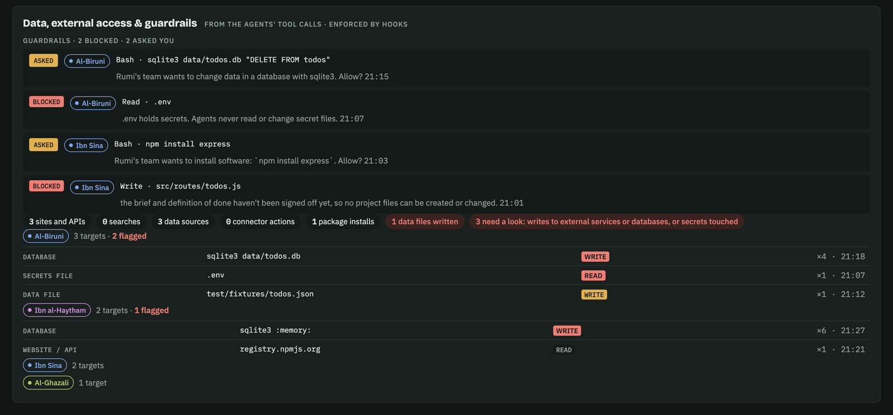

# Rumi's agent team

A small team of AI agents that builds software for you inside Claude Code, while you watch on a live board.

You describe what you want in plain words. The team plans it, checks the plan with you, builds it, tests it, and shows every step as it happens.

| Who | Role | What they do |
|---|---|---|
| **Rumi** | Product manager | Turns your request into a plan, runs the team, makes decisions, and asks you when something needs your call |
| **Al-Ghazali** | Business analyst | Questions the plan before anything is built, looking for gaps, unclear wording and risks |
| **Ibn Sina, Al-Biruni, Ibn Hazm, Ibn Bajja** | Developers | Build one piece each |
| **Ibn al-Haytham, Ibn Rushd** | Testers (QA) | Check the work really does what was agreed |

The team is named after philosophers and scientists of the Islamic golden age.



<sub>Screenshots show the board with example data.</sub>

---

## What you need

- **A paid Claude account** (Pro, Max, Team or Enterprise).
- **Claude Code**, Claude's coding tool. Install it by following the guide at **https://code.claude.com/docs**, and sign in with your Claude account when it asks. You can use it in a terminal window or in the Claude desktop app.

You don't need to know how to code.

---

## Install (once, about 2 minutes)

1. **Open a terminal window.**
   - Mac: press `⌘ Space`, type **Terminal**, press Enter.
   - Windows: press the Windows key, type **PowerShell**, press Enter.
2. **Paste these two lines,** one at a time, pressing Enter after each:

   ```
   claude plugin marketplace add farazfookeer/rumi-team
   ```
   ```
   claude plugin install rumi-team@faraz-agents
   ```

3. You should see **"Successfully installed plugin: rumi-team"**. That's it.

---

## Use it

1. **Open a project folder in Claude Code.** Use the folder where you want the work done; an empty folder is fine for something new.
   - **Desktop app:** start a new Code session and choose the folder.
   - **Terminal:** go to the folder (for example `cd ~/Documents/my-app`), then type `claude` and press Enter.
2. **Type `/rumi-team:rumi` followed by what you want,** for example:

   ```
   /rumi-team:rumi build a simple web page where I can keep a reading list, with a box to add books and a tick to mark them read
   ```

3. **The first time only,** Rumi creates your own private **Agent Team Board** and gives you the link. Open it in your browser and keep it open: it updates live. Rumi also asks whether board updates can happen without asking you each time. Saying yes means fewer pop-ups.

### What happens next

1. **Rumi plans the work** and writes a **definition of done**: a short checklist of what "finished" means.
2. **Al-Ghazali questions the plan** for gaps. Rumi fixes what it can, and asks you about anything only you can decide.
3. **You sign off the plan** on the board (or by replying in Claude Code). **Nothing gets built until you do.** If something's wrong, press **Request changes** and say what you want.
4. **For a new project, the team sets up the workspace first:** sensible folders, a working run and test setup, and a `CLAUDE.md` file describing your project, so every future Claude session understands it.
5. **The developers build it** and **the testers check it.** Work that fails a test goes back to be fixed.
6. **If the team needs you,** a question appears at the top of the board under **Needs you**, and in Claude Code. Answer in either place.
7. **When it's done,** Rumi gives you a summary of what was built, what was checked, and anything left over.

### Your board shows

**Brief and definition of done.** Your request, Rumi's understanding of it, how it will be built, the checklist you sign off, and the business analyst's findings. *(Shown at the top of this page.)*

**Needs you.** Questions and approvals waiting for you. Answer with one click.



**Requirements.** Cards moving from Backlog → In development → In test → Done, with who's working on each one and how many checks have passed.



**Handoffs.** A live diagram of who's working on what, the model each agent uses, and who passed work to whom.



**Decisions and project files.** Every decision Rumi made, with the reason, next to your project's folders. Files the team changed are tagged with the agent who changed them.



**Tool calls.** Every action each agent took, searchable, for checking afterwards. Passwords and keys are hidden.



**Token burn.** How much Claude usage each agent and each model used.



**Data, external access and guardrails.** Websites, databases and files the agents touched, and everything the guardrails blocked or asked you about. Anything risky is flagged in red.



### Just want a project set up?

To get a ready-to-work folder without a full build, open an empty folder in Claude Code and type:

```
/rumi-team:scaffold a website for my bakery with a menu and opening hours
```

You get folders, a working starting point, a README, and a `CLAUDE.md` tailored to your project.

---

## Safety guardrails

While Rumi's team is working, built-in guardrails check **every action, by every agent**, before it happens. These are hard rules enforced by the plugin, not just instructions:

| | What happens |
|---|---|
| **Blocked** | Changing any project files before you sign off the plan |
| **Blocked** | Reading or changing secret files (`.env`, keys, passwords) |
| **Blocked** | Deleting anything outside the project folder, and force-pushing code |
| **Asks you first** | Installing software, changing data in a database, saving to git (commit or push), contacting an outside website or service, and sending or changing things in your connected apps (email, drive and so on) |

When something is blocked or needs your OK, it shows on the board under **Guardrails**. "Asks you first" appears as a normal Claude Code approval prompt. If you're not there to answer, the answer is no. The guardrails switch off when the run ends, so your normal Claude Code use is unaffected.

---

## Good to know

- **The team edits files in the folder you open.** Use a new folder, or a copy of your project, until you're comfortable with it.
- **Risky steps need your OK.** Before installing new software, changing or deleting data, deleting files, or contacting outside services, the team stops and asks you under **Needs you**.
- **It uses your Claude plan's usage.** Bigger requests use more. The **Token burn** panel shows exactly where it went.
- **Your board is private.** Only you can see it, unless you share it from the board's **Share** menu.
- **Without a claude.ai sign-in** (for example, using Claude Code with an API key), the team still works but there's no live board. Progress shows in Claude Code instead.

---

## Updating, removing and fixing problems

**Get the latest version.** Run these in a terminal, then start a new Claude Code session:

```
claude plugin marketplace update faraz-agents
```
```
claude plugin update rumi-team@faraz-agents
```

**Remove it:**

```
claude plugin uninstall rumi-team@faraz-agents
```

**"Unknown command /rumi-team:rumi"**: start a new Claude Code session after installing. Already-open sessions don't see new plugins.

**The board isn't updating**: make sure you're signed in to Claude Code with your claude.ai account, then type `/rumi-team:setup` to check the board connection.

**I want a fresh board**: type `/rumi-team:setup make me a new board`.

**Too many "allow this?" pop-ups**: type `/rumi-team:setup` and ask it to allow board updates without asking.

---

## For the curious

```
.claude-plugin/marketplace.json     lets Claude Code install the plugin from this repo
plugins/rumi-team/
  agents/                           the team: rumi, business-analyst, developer, qa-tester
  skills/rumi/                      the /rumi-team:rumi command
  skills/setup/                     the /rumi-team:setup command (creates your board)
  skills/scaffold/                  the /rumi-team:scaffold command (sets up a project and its CLAUDE.md)
  hooks/hooks.json                  the guardrails: checks every tool call during a run
  scripts/guard.py                  the guardrail rules
  scripts/run_state.py              switches the guardrails on and off for a run
  board/board.html                  the live board page
  scripts/telemetry.py              reads token use, tool calls and data access from Claude Code's logs
  scripts/tree.py                   takes a snapshot of the project's folders for the board
```

Your board's address is saved in `~/.claude/rumi-team/config.json`.

## Licence

MIT. See [LICENSE](LICENSE).
